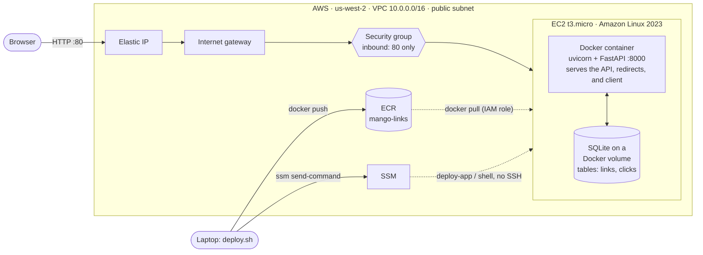

# Mango Links

A small URL shortener on AWS. Paste a URL and get a short link back. Every visit is counted, and the **Dashboard** tab shows totals, visits per day for the last 14 days, and the most visited links.

- **Server:** FastAPI (Python, managed with uv) with SQLite
- **Client:** React + Vite + TypeScript + shadcn/ui, built with Bun
- **Deploy:** one Docker image in ECR, running on an EC2 t3.micro (Amazon Linux 2023), provisioned with Terraform

## Architecture



**How a request travels:**

1. The browser opens `http://184.34.130.242`, the Elastic IP attached to the instance.
2. The internet gateway routes it into the VPC's public subnet. The security group lets it through only because it's TCP port 80.
3. On the instance, Docker maps host port 80 to the container's port 8000, where uvicorn/FastAPI is listening.
4. FastAPI reads or writes SQLite (a file on a Docker volume on the instance's disk) and builds the response: HTML, JSON, or a `302` redirect.
5. The response goes back out the same way: container, host, internet gateway, browser.

Every request goes to the one container:

| Path | What it does |
|---|---|
| `/` and `/assets/*` | the built React client (Shorten and Dashboard tabs) |
| `POST /api/links`, `GET /api/links` | create a short link (max 5/min per IP, else `429`), list the 20 newest active |
| `GET /api/stats` | dashboard numbers: totals, 14-day visits, top 5 |
| `GET /health` | runs a real query; `200 {"database":"ok"}` or `503` |
| `GET /{code}` | `302` to the original URL and records a visit; `404` once the link is older than 3 days |

## Run locally

**With Docker only** (nothing else to install):

```bash
docker build -t mango-links .
docker run --rm -p 8000:8000 -v mango-data:/data mango-links
```

Open http://localhost:8000. This is the same image that runs on EC2: the client, the API, redirects, the dashboard and `/health`. Data lives in the `mango-data` volume. Remove it with `docker volume rm mango-data`.

**For development** (needs uv and Bun):

```bash
cd server && uv run uvicorn main:app --reload   # API on :8000
cd client && bun install && bun dev             # UI on :5173, proxies /api and /health
cd server && uv run pytest                      # tests
```

Short-link redirects are handled by FastAPI, not the Vite dev server. To try them locally, run `bun run build` in `client/` and open http://localhost:8000.

## Deploy

Requires the AWS CLI with working credentials, Terraform, and Docker.

```bash
terraform -chdir=infra init
terraform -chdir=infra plan -out=tfplan   # review: VPC, subnet, IGW, SG, IAM role, ECR, EC2, Elastic IP
terraform -chdir=infra apply tfplan       # applies exactly what you reviewed
./deploy.sh                               # build for linux/amd64, push to ECR, restart over SSM
```

On first boot the instance installs Docker and retries the image pull until the first push arrives, so `apply` followed by `deploy.sh` is enough. After that, `./deploy.sh` redeploys.

### Tear down

```bash
./teardown.sh
```

It runs `terraform plan -destroy`, shows every resource it will delete, and applies that exact plan only after you type `yes`. The ECR repo has `force_delete` so leftover images don't block it, and the Elastic IP is released so nothing keeps billing. Afterwards, `aws ec2 describe-instances --region us-west-2` and `aws ecr describe-repositories --region us-west-2` should come back empty.

Shell access: `aws ssm start-session --target $(terraform -chdir=infra output -raw instance_id)`

## Design decisions

| Choice | Picked | Considered | Why not the alternative |
|---|---|---|---|
| Instance | **t3.micro** (2 vCPU burst, 1 GB) | t4g.micro (ARM) | Also free tier, but Apple Silicon builds would need arm64 images while most of the tooling and docs assume x86. A one-process app doesn't need more. |
| Linux | **Amazon Linux 2023** | Ubuntu 24.04 | AL2023 ships with the AWS CLI and SSM agent already installed and is tuned for EC2, so there's less first-boot setup. |
| Database | **SQLite on a Docker volume** | RDS Postgres (free tier db.t3.micro) | RDS means a second always-on service, a DB subnet group, credentials to manage, and 750 more free-tier hours to watch. SQLite is a real SQL database that survives redeploys, and one instance doesn't need more. It's the first thing to change for real customers. |
| Traffic in | **Elastic IP straight to the instance, port 80** | ALB + HTTPS | An ALB bills by the hour plus usage (roughly $16+/month once outside free-tier allowances), and HTTPS needs a domain. One instance has nothing to load-balance. |
| Admin access | **SSM Session Manager** | SSH with a key pair | No port 22 open and no private key to leak or rotate. Access is controlled by IAM and logged. |
| Deploys | **Docker image in ECR, pulled by the instance** | Copy code with scp/rsync and run it under systemd | The image I test locally is exactly what runs in production, and a rollback is pulling the previous image. |

**Nice-to-haves picked: Docker + Terraform.** Docker gives one reproducible artifact, so "works on my machine" and "works on EC2" are the same thing. Terraform means the whole environment, including the VPC, is in code: it's reviewable, recreatable in any account (that's how the missing default VPC got fixed, see Problems), and `./teardown.sh` removes everything so nothing keeps billing. CI/CD and HTTPS are the next two; see "Before real customers".

## Security & cost

- Only port 80 is open. There is no SSH port and no key pair; admin access goes through SSM Session Manager.
- The instance role can only pull from ECR and register with SSM. No AWS keys live on the box or in the repo.
- IMDSv2 is required, the root volume is encrypted, and the container runs as a non-root user.
- Free tier: t3.micro, an 8 GB gp3 volume, and one public IPv4. ECR keeps only the last 3 images, which stays under the 500 MB free storage. VPC, subnet, internet gateway and security group cost nothing.
- **Abuse limits.** The app stays public for an unknown length of time, so:
  - **Rate limit:** each IP can create 5 links per minute. The 6th gets `429` with a `Retry-After` header. The limit uses the TCP source IP, which Docker's port mapping preserves. `X-Forwarded-For` is ignored because anyone can fake it. The counter is in memory, which is right for one process. With more instances it would move to Redis or AWS WAF rate rules.
  - **Expiry:** links expire after 3 days. Every query only sees links newer than 3 days, so an expired link stops redirecting immediately. Expired rows are deleted each time someone creates a link, which is the only thing that grows the links table, so the database stays small with no background job. Visit history is kept 14 days for the chart.
- **Billing:** the account has an AWS Budgets zero-spend budget that alerts by email on the first cent of spending.
- Terraform state and plan files are git-ignored. They hold resource IDs and can hold sensitive values.

## Problems I ran into

**1. `aws login` refused to run.**
The error was `Profile 'default' is already configured with Access Key credentials`. `~/.aws/credentials` still had old access keys (including a session token) under `[default]`, and the CLI won't mix those with a login session. I moved the file aside to `credentials.bak` instead of deleting it, ran `aws login`, and confirmed it with `aws sts get-caller-identity`.

**2. Terraform: `no matching EC2 VPC found` (us-east-1).**
The first version used `data "aws_vpc" { default = true }`. `aws ec2 describe-vpcs` returned nothing at all, because this account had no default VPC in that region. Rather than recreate it by hand, the Terraform now builds its own VPC, public subnet, internet gateway and route table. That works in any account or region, and `destroy` removes it cleanly. I also moved the project to us-west-2; nothing had been applied in us-east-1, which the empty Terraform state and missing ECR repo/IAM role confirmed.

**3. First deploy: SSM command `Failed`, but the site came up anyway.**
`aws ssm get-command-invocation` showed `/usr/local/bin/deploy-app: No such file or directory`. `deploy.sh` ran right after `terraform apply`, so the SSM command reached the new instance before cloud-init had finished the first-boot script that writes `deploy-app`. The site still came up because that script's own retry loop pulled the image. The root fix: the SSM command now runs `cloud-init status --wait` before `deploy-app`, and `deploy.sh` waits for the result and prints stderr if it fails.

**4. The Copy button did nothing on the live site, but worked locally.**
`navigator.clipboard` exists only in a *secure context* (HTTPS or `localhost`). Locally the page is on `localhost`, so it worked. The live site is plain `http://<ip>`, where `navigator.clipboard` is `undefined`, so the click threw an error. The fix falls back to a hidden `<textarea>` with `document.execCommand("copy")` when the Clipboard API is missing. The real long-term fix is HTTPS (see below).

**5. The dashboard's "today" came from the browser clock.**
The first version filled in empty days in the browser using `Date.now()`, and ESLint's React purity rule flagged it. It was also a real bug: visits are stored in UTC by SQLite, so a viewer in a different timezone, or with a wrong clock, would see days shifted. The server now builds the 14-day window from the same UTC clock as the database, and the client just draws it.

## Before real customers

- **HTTPS:** a domain plus an ALB with an ACM certificate, or CloudFront in front of the instance. It also lets the Clipboard API work natively.
- **Database:** move SQLite to RDS Postgres, with automated backups and a separate data lifecycle from the instance.
- **More than one server:** an Auto Scaling group across two availability zones behind the ALB, and zero-downtime rolling deploys.
- **CI/CD:** GitHub Actions with OIDC, so there are no long-lived AWS keys; it runs tests, builds, pushes and deploys on merge.
- **Abuse controls:** the per-IP rate limit and 3-day expiry exist already. Next would be a URL blocklist or a Google Safe Browsing check, because a public shortener attracts phishing links, plus WAF rate rules at the edge.
- **Monitoring:** CloudWatch alarms on `/health`, instance status checks, and a billing alarm.
